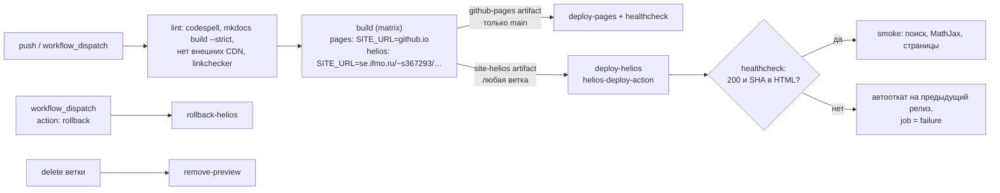

# P4. Развёртывание на Helios с контролем качества доставки

!!! abstract "Итог"
    - [x] выкладка на Helios по SSH/rsync с **отдельным deploy-ключом**, ключ хоста проверяется (закреплённый `known_hosts`);
    - [x] **healthcheck** после выкладки: код 200 и SHA коммита в HTML, при несовпадении — красный job и **автооткат**;
    - [x] **превью веток**: `main` → `/~s367293/ssg-report/`, ветка `X` → `/~s367293/ssg-report/preview/X/`, удаление ветки удаляет превью;
    - [x] **откат**: хранятся 5 последних релизов, возврат — `workflow_dispatch` (`action: rollback`) за ~11 с;
    - [x] продемонстрирован **обрыв выкладки на середине** — опубликованная версия не пострадала;
    - [x] сравнение с GitHub Pages — по времени доставки, надёжности и удобству отладки.

    Выкладку выполняет собственный action [`troublegale/helios-deploy-action`](challenge.md), закреплённый по SHA коммита.

## Схема



Раскладка на сервере (каталоги вне `public_html`, наружу смотрят только симлинки):

```text
~/public_html/ssg-report ──► ~/.deploy/ssg-report/releases/20261018T220110Z-250d346   (активный релиз main)
~/.deploy/ssg-report/
├── releases/                     # 5 последних релизов main: <UTC-время>-<sha7>
│   ├── 20261018T214434Z-bff9053/
│   ├── …
│   └── 20261018T220110Z-250d346/
│       ├── index.html …
│       └── preview ──► ~/.deploy/ssg-report/shared/preview      (shared-каталог, переживает смену релизов)
├── shared/preview/
│   └── feature-preview-demo ──► ~/.deploy/ssg-report-previews/feature-preview-demo/releases/…
└── history                       # журнал активаций (для отката)
~/.deploy/ssg-report-previews/<ветка>/releases/…                  # релизы превью
```

## Deploy-ключ и проверка хоста

1. Отдельная пара ключей только для CI: `ssh-keygen -t ed25519 -N "" -C "ssg-report-deploy@github-actions" -f ~/.ssh/helios_deploy`.
   Личный ключ (или пароль) в CI не используется.
2. Публичная часть добавлена в `~/.ssh/authorized_keys` на Helios (один раз, по паролю, вручную).
3. Приватная часть — секрет репозитория `HELIOS_SSH_KEY` (`gh secret set HELIOS_SSH_KEY < ~/.ssh/helios_deploy`), в логах
   маскируется: `ssh-key: ***`, `HD_KEY: ***`. В файловой системе раннера ключ живёт только во временном каталоге
   с правами `0600` и удаляется `trap … EXIT`.
4. **Ключ хоста не отключается** (`StrictHostKeyChecking=yes`, свой `UserKnownHostsFile`). Значение — переменная
   репозитория `HELIOS_KNOWN_HOSTS`. Fingerprint сверен по двум каналам: `ssh-keyscan` и `known_hosts` с машины, где вход
   выполнялся интерактивно раньше:

    | Тип | SHA256 |
    |---|---|
    | ED25519 | `3n1x6Bq0hnfyxrWB/YeQQPaxUkE/GCX2vKKtl0nzGgM` |
    | RSA | `xH6+RqQj7mVNJ3oWRblgzhxjdLJoNJ7ze4whon7ShzI` |
    | ECDSA | `gwyf8uH0khUL3O4+0cHO2YPRQD0d2nonu/GlQjrkJoo` |

!!! warning "Ограничение: объём прав deploy-ключа"
    На Helios у студента одна учётная запись, поэтому deploy-ключ даёт **полный shell** этого пользователя, а не только запись
    в `public_html`. При компрометации секрета злоумышленник получает доступ ко всем файлам домашнего каталога.
    Смягчение, которое здесь применено: ключ отдельный (отзывается удалением одной строки из `authorized_keys`, не затрагивая
    пароль), секрет доступен только job-ам с `environment: helios`, workflow не запускает деплой на `pull_request`.
    Что можно сделать дополнительно: опции `restrict,command="rrsync ~/.deploy"` в `authorized_keys` (ограничение ключа
    одной командой rsync) — но тогда action не сможет выполнять `ln`/`mv` для атомарного переключения; это компромисс
    между атомарностью и минимальными правами.

## Атомарные релизы

Каждая выкладка — новый каталог `releases/<время>-<sha>`:

1. `ssh`: создать каталоги, узнать текущий релиз (`readlink` симлинка);
2. `rsync -rlzc --delete --link-dest=../<текущий>` в новый каталог. Неизменившиеся файлы становятся **жёсткими ссылками**
   на предыдущий релиз, а предыдущий релиз служит базой для дельта-передачи — по сети уходят только изменения;
3. `ssh`: подложить симлинки shared-каталогов, создать симлинк `target.hd-new` и переименовать его поверх `target`
   (`mv -h` на FreeBSD, `mv -T` на Linux). `rename(2)` атомарен: посетитель видит либо старую версию целиком, либо новую;
4. удалить релизы сверх `keep-releases` (активный не удаляется никогда).

Эффект `--link-dest` измерен: при ограничении `--bwlimit=40` КБ/с выкладка заняла те же ~8 с, что и без ограничения,
а при `--bwlimit=1` КБ/с — 12 с ([39169229564](https://github.com/troublegale/ssg-report/actions/runs/39169229564)):
передаётся лишь несколько килобайт изменившихся HTML (меняется метка сборки в подвале), а не 3,6 МБ сайта.

## Healthcheck и автооткат

После переключения action запрашивает опубликованный URL (6 попыток через 5 с, `Cache-Control: no-cache`) и ищет
в ответе SHA коммита — он записан хуком `hooks/build_info.py` в `<meta name="ssg-build-commit">`. Это проверяет не просто
«сайт отвечает», а «отвечает **именно эта** сборка». Отдельный smoke-шаг проверяет поисковый индекс, MathJax и страницы.

Намеренно проваленный запуск: `workflow_dispatch` с `break_healthcheck: true` (ожидается несуществующая строка) —
[39168536318](https://github.com/troublegale/ssg-report/actions/runs/39168536318):

```text
healthcheck: попытка 6/6 не прошла
##[error]healthcheck не прошёл: https://se.ifmo.ru/~s367293/ssg-report/ (ожидалась строка: NO-SUCH-BUILD-MARKER)
##[error]выполнен автоматический откат на 20261018T213306Z-bff9053
##[error]Process completed with exit code 1.
```

Разбор лога: rsync и переключение прошли (`active: 20261018T213647Z-bff9053`), затем 6 попыток healthcheck не нашли
контрольную строку, action вернул симлинк на предыдущий релиз и завершился с кодом 1 — job `deploy-helios` красный,
smoke-тест не выполнялся. Сайт оставался рабочим всё время. Этот запуск выявил ошибку в логике отката — [E4](otladka.md#e4).

Второй тип провала — на стадии lint: ветка с битой ссылкой ([39168389883](https://github.com/troublegale/ssg-report/actions/runs/39168389883)):

```text
WARNING -  Doc file 'p4.md' contains a link 'no-such-page.md', but the target is not found among documentation files.
Aborted with 1 warnings in strict mode!
```

Сборка остановилась на `mkdocs build --strict`, до `build` и `deploy` дело не дошло.

## Превью веток

| Ветка | Куда публикуется | Запуск |
|---|---|---|
| `main` | `public_html/ssg-report` → <https://se.ifmo.ru/~s367293/ssg-report/> | [39170303657](https://github.com/troublegale/ssg-report/actions/runs/39170303657) |
| `feature/preview-demo` | `…/shared/preview/feature-preview-demo` → <https://se.ifmo.ru/~s367293/ssg-report/preview/feature-preview-demo/> | [39168379631](https://github.com/troublegale/ssg-report/actions/runs/39168379631) |

Имя ветки приводится к безопасному виду (`[a-z0-9-]`, до 40 символов). Для превью сайт собирается со своим `SITE_URL`,
у превью свои релизы и свой откат. Каталог `preview/` внутри каждого релиза `main` — симлинк на общий каталог,
поэтому выкладка `main` не стирает превью. При удалении ветки событие `delete` запускает `remove-preview`
([39170183467](https://github.com/troublegale/ssg-report/actions/runs/39170183467)):

```text
removed .deploy/ssg-report/shared/preview/demo-interrupt and .deploy/ssg-report-previews/demo-interrupt
```

GitHub Pages так не умеет: у репозитория один сайт, превью веток нет.

## Откат

`Actions → site → Run workflow → action: rollback` (необязательно — `rollback_to: <id релиза>`). Запуск
[39168691545](https://github.com/troublegale/ssg-report/actions/runs/39168691545): job 11 с, из них переключение — 5 с.

```text
##[notice]откат: 20261018T213306Z-bff9053 -> 20261018T213647Z-bff9053
##[notice]healthcheck OK (https://se.ifmo.ru/~s367293/ssg-report/, попытка 1)
```

Состояние релизов выводит `action: status` ([39169843864](https://github.com/troublegale/ssg-report/actions/runs/39169843864)):

```text
target: public_html/ssg-report -> /home/studs/s367293/.deploy/ssg-report/releases/20261018T215447Z-c094166
releases (.deploy/ssg-report/releases):
  20261018T213647Z-bff9053  3675 KB  91 files
  20261018T214228Z-bff9053  3675 KB  91 files
  20261018T214434Z-bff9053  3675 KB  91 files
  20261018T214621Z-bff9053  3675 KB  91 files
  20261018T215447Z-c094166  3675 KB  91 files <- active
```

## Обрыв развёртывания на середине

Эксперимент: новая ветка `demo/interrupt` (первая выкладка — без базы для `--link-dest`, передаётся весь сайт),
`workflow_dispatch` с `bwlimit: 20` (КБ/с), отмена запуска через 25 с после начала шага выкладки
([39169379643](https://github.com/troublegale/ssg-report/actions/runs/39169379643)):

```text
21:48:25 ##[notice]текущий релиз: нет; новый: 20261018T214822Z-a1c137f
21:48:50 (gh run cancel)
21:49:48 ##[error]The operation was canceled.
21:49:48 Terminate orphan process: pid (2157) (rsync)
21:49:48 Terminate orphan process: pid (2158) (ssh)
```

Состояние сервера после обрыва (`action: status`):

```text
target: .deploy/ssg-report/shared/preview/demo-interrupt -> <нет симлинка>
releases (.deploy/ssg-report-previews/demo-interrupt/releases):
  20261018T214822Z-a1c137f  939 KB  36 files
```

Что произошло и почему это безопасно:

| Момент обрыва | Состояние | Видят посетители |
|---|---|---|
| во время rsync (продемонстрировано) | неполный каталог релиза (36 из 91 файла), симлинк не тронут | предыдущую версию целиком (здесь — превью ещё не существовало, 404) |
| между rsync и переключением | полный, но не активированный релиз | предыдущую версию |
| во время переключения | `rename(2)` атомарен | старую **или** новую версию, не смесь |
| после переключения, до healthcheck | новая версия активна, проверка не выполнена | новую версию; следующий запуск её проверит |

Неполный релиз не мешает следующей выкладке (у неё новый каталог) и удаляется очисткой по `keep-releases`.
Повторный запуск на той же ветке прошёл штатно ([39169978643](https://github.com/troublegale/ssg-report/actions/runs/39169978643)).
Наблюдение: отмена через GitHub не мгновенна — rsync был остановлен через 58 с после команды отмены.

Для сравнения, при обычном `rsync --delete` прямо в `public_html` (режим `strategy: direct`) обрыв оставил бы **смесь**
старых и новых файлов: rsync заменяет каждый файл атомарно, но не весь набор — страницы новой версии ссылались бы на
ещё не загруженные ассеты.

## Сравнение с GitHub Pages { #sravnenie }

### Время доставки

Время job и шага выкладки из API GitHub Actions по успешным запускам этого репозитория (Helios — 6 запусков, Pages — 8).
Шаг Helios включает три SSH-сеанса, rsync, переключение и healthcheck; шаг Pages — `deploy-pages`.

| Площадка | Job, с: медиана (мин–макс) | Шаг выкладки, с: медиана (мин–макс) | Видимость новой версии |
|---|---:|---:|---|
| GitHub Pages | 9,5 (8–12) | 6 (5–8) | сразу после шага, healthcheck — с 1-й попытки во всех запусках |
| Helios (`main`, повторная выкладка) | 27,5 (27–28) | 13 (12–15) | сразу после переключения симлинка, healthcheck — с 1-й попытки |
| Helios (первая выкладка превью, без базы) | 33 (30–36) | 18 (16–20) | то же |

Разбивка шага Helios (запуск [39170303657](https://github.com/troublegale/ssg-report/actions/runs/39170303657), повторная
выкладка `main`; и [39169978643](https://github.com/troublegale/ssg-report/actions/runs/39169978643), первая выкладка превью):

| Этап | Повторная, с | Первая (весь сайт), с |
|---|---:|---:|
| SSH: подготовка, текущий релиз | 3,2 | 4,3 |
| rsync + SSH: shared, переключение, очистка | 7,4 | 8,8 |
| healthcheck | 1,5 | 2,2 |
| **итого** | **12,1** | **15,3** |

Основное время — установление SSH-сессий из дата-центра GitHub (США) до Helios (~1,5–2 с на сессию), а не передача данных.
Это согласуется с моделью \(T = n_\text{ssh} t_\text{ssh} + S_\Delta/B + \dots\) из [хода работы](hod-raboty.md#proverka).

### Остальные критерии

| Критерий | GitHub Pages | Helios ИТМО |
|---|---|---|
| Надёжность доставки | управляемый сервис, раздача через CDN, артефакт разворачивается целиком | один сервер без CDN; атомарность обеспечивает action. Защита от перебора на сервере блокирует IP после серии соединений без аутентификации — на всех портах, включая HTTPS ([E2](otladka.md#e2)) |
| Доступность из CI | без ограничений | с раннеров GitHub — без отказов во всех запусках этой работы |
| Удобство отладки | только логи `deploy-pages`, содержимое выкладки не посмотреть | полный доступ по SSH, `action: status`, видны все релизы и журнал активаций |
| Откат | перезапуск старого workflow (пересборка) или новый коммит | переключение симлинка на сохранённый релиз, ~5 с, без пересборки |
| Превью веток | нет (один сайт на репозиторий) | да, сколько угодно подкаталогов |
| Права в CI | `pages: write` + OIDC, без доступа к коду | SSH-ключ с полным shell учётной записи |
| HTTPS, свой домен | да / да | да (`se.ifmo.ru`) / нет |
| Поведение при обрыве | разворачивание артефакта атомарно на стороне GitHub | атомарно при `strategy: atomic`, смешанная версия при `direct` |

**Вывод.** GitHub Pages быстрее (в 2–3 раза по времени job) и надёжнее как площадка, но беднее как механизм доставки: нет превью,
откат только пересборкой, нет доступа к содержимому. Helios медленнее из-за SSH-рукопожатий и зависит от одного сервера,
но с атомарными релизами даёт превью веток, мгновенный откат и полную наблюдаемость. Поэтому сайт публикуется на обе площадки:
Pages — основная копия, Helios — копия на отечественной площадке с превью.
